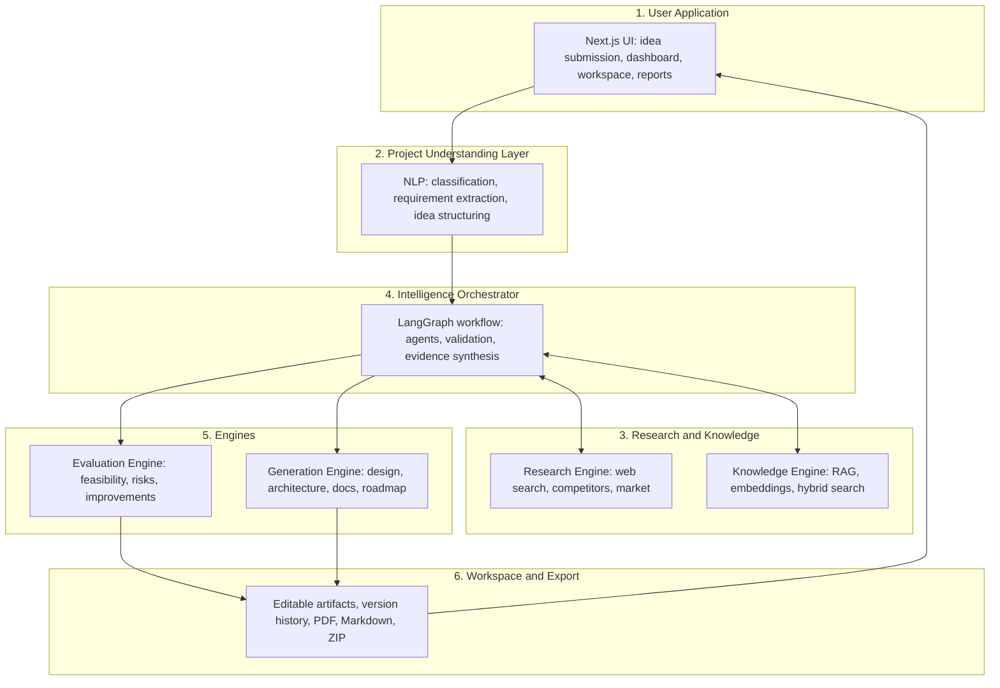
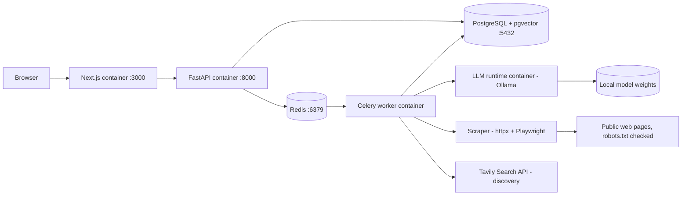
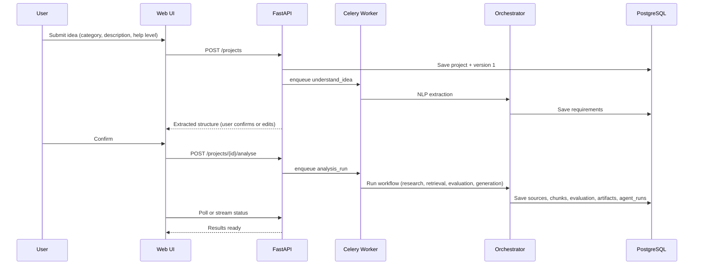
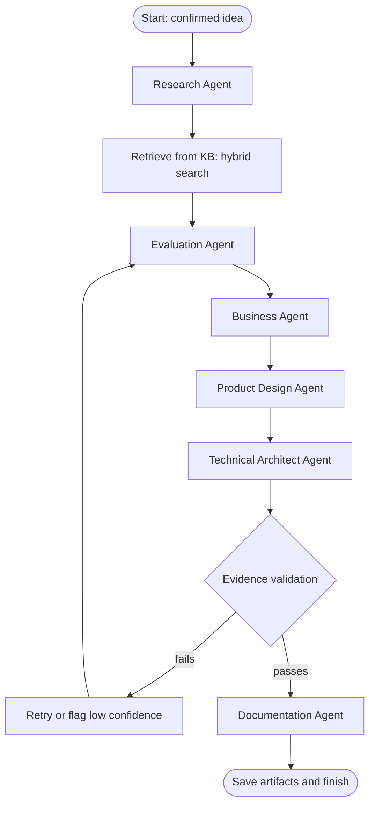
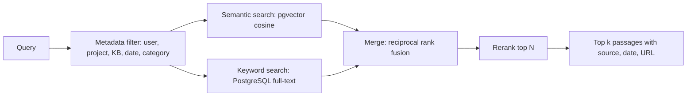

# Ideaform: System Architecture

| Field | Value |
| --- | --- |
| Document | architecture.md |
| Version | 1.0 (blueprint freeze) |
| Related docs | SRS.md, database_design.md, AI_DESIGN.md, implementation_plan.md |

---

## 1. Architectural Principles

1. **Layered and modular:** each engine has one responsibility and can be replaced without rebuilding the app.
2. **Central orchestrator, few agents:** six agents, coordinated by one workflow, using shared NLP and RAG services.
3. **Evidence first:** every claim is traceable to a source or labelled as assumption/suggestion.
4. **One database:** PostgreSQL (+ pgvector) for relational data, vectors, runs, and artifacts.
5. **Asynchronous long tasks:** heavy AI work runs in background workers, never blocking the UI.
6. **Provider independence:** LLM and search providers sit behind interfaces.
7. **Privacy by design:** project-level isolation for private knowledge.
8. **Local intelligence, one search API:** every model, embedding, and reranker runs locally; Tavily is used only to discover URLs, and all content is fetched by our own scraper.

---

## 2. High-Level Architecture (six layers)



### Layer responsibilities

| Layer | Responsibility | Main technology |
| --- | --- | --- |
| User Application | Idea submission, dashboard, workspace, reports | Next.js, TypeScript, Tailwind, shadcn/ui |
| Project Understanding | Classify idea, extract requirements, structure it | spaCy, Sentence Transformers, LLM |
| Research Engine | Live web research, competitors, market data | Tavily for discovery; self-hosted scraper (httpx + Playwright) with robots.txt guard and per-platform adapters for content |
| Knowledge Engine | Ingestion, embeddings, hybrid retrieval, reranking | PostgreSQL + pgvector, local sentence-transformers + cross-encoder |
| Intelligence Orchestrator | Runs agent workflows, validates, synthesises evidence | LangGraph, Pydantic |
| Evaluation Engine | Six-dimension scoring, risks, improvements | Local LLM + retrieved evidence |
| Generation Engine | PRD, diagrams, schema, API spec, UI/UX, roadmap | Local LLM + templates |
| Workspace and Export | Artifacts, versions, export | PostgreSQL, python-docx, ReportLab |

---

## 3. Deployment Architecture



### Containers (docker-compose)
| Service | Image / build | Purpose |
| --- | --- | --- |
| `web` | Node 20 | Next.js frontend |
| `api` | Python 3.11 | FastAPI REST API |
| `worker` | Same as api | Celery tasks (research, agents, generation, export) |
| `db` | `pgvector/pgvector:pg16` | PostgreSQL with vector extension |
| `redis` | `redis:7` | Queue and cache |
| `ollama` | `ollama/ollama` | Local model runtime (GPU optional); models pulled at setup, no API key |

No container calls a paid API. The `worker` image bundles Chromium/Playwright for JS-rendered pages.

### Configuration (environment variables)
```
DATABASE_URL=postgresql+psycopg://user:pass@db:5432/ideaform
REDIS_URL=redis://redis:6379/0

# Local inference only - no provider keys anywhere
LLM_BACKEND=ollama                    # ollama | transformers (in-process)
OLLAMA_BASE_URL=http://ollama:11434
LLM_MODEL_FAST=qwen2.5:3b-instruct    # extraction, drafts, query planning
LLM_MODEL_STRONG=qwen2.5:7b-instruct  # evaluation, generation
LLM_CONTEXT_WINDOW=8192
LLM_REQUEST_TIMEOUT=180
EMBEDDING_MODEL=sentence-transformers/all-MiniLM-L6-v2
RERANKER_MODEL=cross-encoder/ms-marco-MiniLM-L-6-v2

# Live discovery - the only paid external API
SEARCH_PROVIDER=tavily
TAVILY_API_KEY=...
TAVILY_MAX_RESULTS=10
TAVILY_RESULTS_PER_RUN=40
TAVILY_SEARCH_DEPTH=basic       # basic (1 credit) | advanced (2 credits)
TAVILY_CACHE_TTL_HOURS=168

# Self-hosted scraper
SCRAPER_USER_AGENT="IdeaformBot/1.0 (+contact-url)"
SCRAPER_RESPECT_ROBOTS=true
SCRAPER_MIN_DELAY_SECONDS=2
SCRAPER_MAX_PAGES_PER_RUN=40
SCRAPER_MAX_BYTES_PER_PAGE=2000000
SCRAPER_PLAYWRIGHT_ENABLED=true
SCRAPER_TIMEOUT_SECONDS=20

JWT_SECRET=...
DAILY_TOKEN_LIMIT_PER_USER=...
```

---

## 4. Backend Structure

```
backend/
  app/
    main.py                  # FastAPI entry
    core/                    # config, security, logging
    api/                     # routers: auth, projects, research, evaluation, generation, export
    models/                  # SQLAlchemy models
    schemas/                 # Pydantic request/response and LLM output schemas
    services/
      nlp/                   # classification, extraction
      knowledge/             # ingestion, chunking, embeddings, hybrid search, rerank
      research/              # Tavily discovery client, crawl queue, source store, provenance
      scrapers/              # universal scraper, robots/rate-limit guard, platform adapters, text extraction
      llm/                   # local runtime client (Ollama / transformers), prompt loader, JSON-validated calls
      evaluation/            # scoring, risk, improvement
      generation/            # PRD, diagrams, schema, API spec, roadmap
      export/                # markdown, pdf, zip
    agents/                  # six agents and the LangGraph workflow
    workers/                 # Celery app and tasks
    prompts/                 # versioned prompt templates
  tests/
  alembic/
```

### Frontend structure
```
frontend/
  app/                       # Next.js routes: /login, /dashboard, /projects/[id]/...
  components/                # ScoreCard, SourceList, VersionCompare, MermaidViewer, ...
  lib/                       # API client, types
```

---

## 5. Main Processing Pipeline



### Steps in detail
1. **Intake:** project and version 1 are saved.
2. **Understanding:** NLP extracts category, problem, users, features, technologies, and requirement candidates. The user confirms.
3. **Research:** the Research Agent plans queries, asks Tavily for candidate URLs, then crawls those pages (plus curated KB sources) with the universal scraper, respecting robots.txt and rate limits, and stores sources with provenance.
4. **Retrieval:** passages are chunked, embedded, and queried with hybrid search across KB-A, KB-B, and KB-C (filtered by project and user).
5. **Evaluation:** the Evaluation Agent scores six dimensions using retrieved evidence.
6. **Business and design:** Business and Product Design agents produce the business model, requirements, and user flows.
7. **Technical design:** the Technical Architect Agent produces stack, architecture, schema, and API design.
8. **Documentation:** the Documentation Agent assembles the PRD, roadmap, and exports.
9. **Validation:** an evidence check confirms citations exist and claim labels are set.
10. **Delivery:** artifacts are saved and shown in the workspace.

---

## 6. Agent Workflow (LangGraph)



### Shared state object
```python
class ProjectState(TypedDict):
    project_id: str
    version_id: str
    category: str
    idea_summary: str
    requirements: list[dict]
    sources: list[dict]          # url, title, date, passages
    evidence: list[dict]         # retrieved chunks with ids
    evaluation: dict             # six dimensions
    business_model: dict
    product_design: dict
    technical_design: dict
    artifacts: dict
    errors: list[str]
    status: str
```

### Agent summary
| Agent | Inputs | Tools | Output |
| --- | --- | --- | --- |
| Research | idea summary, keywords | search API, fetcher, RAG | sources, competitor list |
| Evaluation | requirements, evidence | RAG | six scores, risks, Devil's Advocate, improvements |
| Business | evaluation, evidence | RAG | customers, pricing, revenue, business model |
| Product Design | requirements | KB-B | requirements, user flows, screens |
| Technical Architect | requirements, design | KB-B | stack, architecture, schema, API |
| Documentation | all outputs | templates | PRD, roadmap, exports |

Agents are specified in detail in `AI_DESIGN.md`.

---

## 7. Knowledge Engine and Hybrid Retrieval



- **Collections** are logical, separated by the `kb` metadata column: `A` (Business), `B` (Technical), `C` (Project, private).
- **Isolation rule:** every query includes `kb IN ('A','B') OR (kb = 'C' AND project_id = :current_project AND user_id = :current_user)`.
- **Citations:** each passage keeps `source_id`, `url`, `retrieved_at`, and chunk position.

---

## 8. REST API Overview

| Method | Endpoint | Purpose |
| --- | --- | --- |
| POST | `/auth/register`, `/auth/login` | Account and token |
| GET/POST | `/projects` | List / create projects |
| GET/PATCH/DELETE | `/projects/{id}` | Read, update, delete |
| POST | `/projects/{id}/understand` | Run NLP extraction |
| PATCH | `/projects/{id}/requirements` | Confirm or edit requirements |
| POST | `/projects/{id}/analyse` | Start full analysis (background) |
| GET | `/runs/{run_id}` | Status and progress |
| GET | `/projects/{id}/sources` | Research sources |
| GET | `/projects/{id}/evaluations?version=` | Evaluation per version |
| POST | `/projects/{id}/improve` | Apply improvements and create new version |
| GET | `/projects/{id}/compare?a=&b=` | Compare two versions |
| GET | `/projects/{id}/artifacts` | List artifacts |
| POST | `/projects/{id}/artifacts/{type}/regenerate` | Regenerate one section |
| PATCH | `/artifacts/{id}` | Edit artifact (creates new version) |
| POST | `/projects/{id}/documents` | Upload private document |
| POST | `/projects/{id}/export?format=pdf|md|zip` | Export |

All endpoints except auth require a valid token and verify ownership of the project.

---

## 9. Cross-Cutting Concerns

### 9.1 Security
- Argon2/bcrypt password hashing, JWT access tokens with expiry.
- Ownership check on every project, artifact, and document query.
- Input validation (Pydantic), file type and size limits for uploads.
- Secrets only from environment variables; `.env` excluded from Git.
- Prompt-injection defence: web page and document text is treated as **data, never instructions**; system prompts state this explicitly.

### 9.2 Reliability and error handling
- Retries with exponential backoff for LLM and search calls (max 3).
- Each agent step saves its output, so a failed run can resume from the last step.
- Structured LLM output is validated with Pydantic; invalid output triggers one repair attempt, then an error with partial results.
- Timeouts on all external calls.

### 9.3 Observability
- `agent_runs` table records agent name, status, timing, token counts, and errors.
- Structured logging with a run id on every log line.

### 9.4 Cost control
- AI inference costs nothing: the only metered call is Tavily URL discovery.
- Small quantised model for extraction and drafts, larger local model for evaluation and generation.
- Cache Tavily results per query (7-day TTL) and embeddings/pages by content hash; reuse a project's scrape corpus on re-evaluation.
- Per-user daily limits, per-run Tavily result caps, and `search_depth=basic` by default.
- Per-run budgets (pages, tokens, wall-clock) so one request cannot monopolise the machine.

### 9.5 Extensibility
- `LLMProvider` and `SearchProvider` interfaces allow switching vendors.
- Prompt templates are versioned files, so prompt changes are tracked in Git.
- New agents or engines can be added as new nodes in the workflow.

---

## 10. Key Design Decisions

| Decision | Reason |
| --- | --- |
| PostgreSQL + pgvector instead of a separate vector DB or MongoDB | One system for relational and vector data; easier to deploy and keep isolated |
| Six agents, not eight or ten | Less overlap, lower cost, simpler to explain and test |
| NLP and RAG as shared services | Avoids duplicated logic; every agent uses the same retrieval |
| Structured scoring instead of one success percentage | More honest and more useful |
| Local LLM only (Ollama, in-process transformers fallback) | No paid APIs and no data leaving the machine; works offline; quality bounded by local hardware |
| Tavily for URL discovery, own scraper for content | Discovery quality of a search API, full control over fetching, rate limits, and citation metadata; only one metered call path |
| Celery workers for AI tasks | Long LLM runs must not block the API |
| Docker for everything | Reproducible setup for the team and the demo |

---

## 11. Risks and Mitigations

| Risk | Mitigation |
| --- | --- |
| LLM hallucination | Retrieved evidence, citations, claim labels, evidence validation step |
| Tavily quota exhausted or API down | Cached discovery results, curated seed URLs, and pre-scraped sample projects |
| Target sites block scraping, change markup, or forbid it in their terms | robots.txt and terms checks, per-domain rate limits, per-platform adapters, cached corpora, pre-scraped sample projects for the demo |
| Local model too slow or too weak on demo hardware | Quantised models, fast/strong split, longer timeouts, cached runs, deterministic extractive fallback |
| High API cost | Cheaper dev model, caching, daily limits |
| Poor retrieval quality | Hybrid search, reranking, tested against a labelled query set |
| Scope creep | Frozen blueprint, phase gates, "do not build initially" list |
| Prompt injection from web content | Treat external text as data; strip instructions; restrict tools |
| Scraped corpus full of low-quality or off-topic pages | Domain allowlist/denylist, content-quality filter before embedding, dedupe by hash and near-duplicate |
