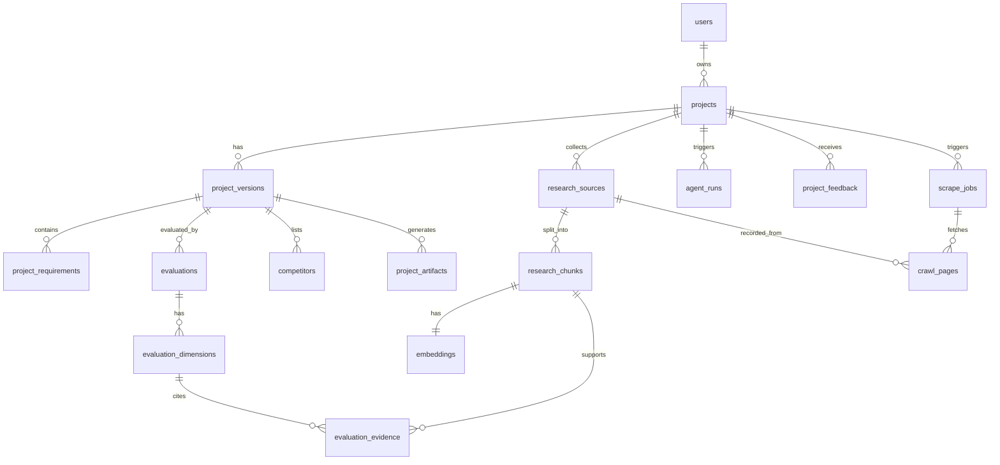

# Ideaform: Database Design

| Field | Value |
| --- | --- |
| Document | database_design.md |
| Version | 1.0 (blueprint freeze) |
| Database | PostgreSQL 16 + pgvector |
| Related docs | SRS.md, architecture.md, AI_DESIGN.md |

---

## 1. Design Principles

1. **One database** for users, projects, research, vectors, runs, and artifacts.
2. **Versioned ideas:** every change to an idea creates a new `project_versions` row, so evaluations can be compared.
3. **Evidence traceability:** every evaluation claim links to chunks, and every chunk links to a source.
4. **Isolation:** private knowledge is always filtered by `user_id` and `project_id`.
5. **Auditability:** every AI run is recorded in `agent_runs`.
6. **UUID primary keys** and `created_at` / `updated_at` timestamps on all tables.

---

## 2. Entity-Relationship Diagram



---

## 3. Table Overview

| Table | Purpose |
| --- | --- |
| users | User accounts |
| projects | User-created projects |
| project_versions | Idea revisions |
| project_requirements | Extracted requirements |
| research_sources | URLs and source metadata |
| research_chunks | Retrieved document passages |
| embeddings | Vector representations |
| evaluations | Feasibility reports (one per version) |
| evaluation_dimensions | The six scored dimensions of an evaluation |
| evaluation_evidence | Links between a dimension and supporting chunks |
| competitors | Competitor information |
| agent_runs | Agent execution history |
| project_artifacts | Generated documents and diagrams |
| project_feedback | User feedback and decisions |
| scrape_jobs | One crawl/scrape run (adapter, seeds, budgets, outcome) |
| crawl_pages | Per-URL fetch log: robots decision, status, hash, provenance |

(`evaluation_dimensions` and `evaluation_evidence` split the evaluation into normalised rows so scores, explanations, and citations can be queried and compared across versions.)

---

## 4. Table Definitions (SQL)

```sql
CREATE EXTENSION IF NOT EXISTS vector;
CREATE EXTENSION IF NOT EXISTS pgcrypto;   -- gen_random_uuid()

-- 4.1 Users
CREATE TABLE users (
    id            UUID PRIMARY KEY DEFAULT gen_random_uuid(),
    email         TEXT UNIQUE NOT NULL,
    password_hash TEXT NOT NULL,
    full_name     TEXT,
    daily_token_limit INTEGER DEFAULT 200000,
    created_at    TIMESTAMPTZ DEFAULT now(),
    updated_at    TIMESTAMPTZ DEFAULT now()
);

-- 4.2 Projects
CREATE TABLE projects (
    id          UUID PRIMARY KEY DEFAULT gen_random_uuid(),
    user_id     UUID NOT NULL REFERENCES users(id) ON DELETE CASCADE,
    title       TEXT NOT NULL,
    category    TEXT NOT NULL CHECK (category IN ('business','software','technology')),
    help_level  TEXT NOT NULL CHECK (help_level IN ('evaluate','research','blueprint','everything')),
    status      TEXT NOT NULL DEFAULT 'draft'
                CHECK (status IN ('draft','analysing','ready','failed','archived')),
    current_version_id UUID,
    created_at  TIMESTAMPTZ DEFAULT now(),
    updated_at  TIMESTAMPTZ DEFAULT now()
);
CREATE INDEX idx_projects_user ON projects(user_id);

-- 4.3 Project versions (idea revisions)
CREATE TABLE project_versions (
    id            UUID PRIMARY KEY DEFAULT gen_random_uuid(),
    project_id    UUID NOT NULL REFERENCES projects(id) ON DELETE CASCADE,
    version_no    INTEGER NOT NULL,
    idea_text     TEXT NOT NULL,
    structured_idea JSONB,              -- problem, users, features, technologies
    change_summary TEXT,                -- what changed from previous version
    parent_version_id UUID REFERENCES project_versions(id),
    created_at    TIMESTAMPTZ DEFAULT now(),
    UNIQUE (project_id, version_no)
);
ALTER TABLE projects
  ADD CONSTRAINT fk_current_version
  FOREIGN KEY (current_version_id) REFERENCES project_versions(id);

-- 4.4 Requirements
CREATE TABLE project_requirements (
    id          UUID PRIMARY KEY DEFAULT gen_random_uuid(),
    version_id  UUID NOT NULL REFERENCES project_versions(id) ON DELETE CASCADE,
    req_type    TEXT NOT NULL CHECK (req_type IN ('functional','non_functional','constraint','assumption')),
    description TEXT NOT NULL,
    priority    TEXT CHECK (priority IN ('must','should','could')),
    source      TEXT CHECK (source IN ('extracted','user','ai_suggestion')),
    confirmed   BOOLEAN DEFAULT false,
    created_at  TIMESTAMPTZ DEFAULT now()
);

-- 4.5 Research sources
CREATE TABLE research_sources (
    id            UUID PRIMARY KEY DEFAULT gen_random_uuid(),
    kb            CHAR(1) NOT NULL CHECK (kb IN ('A','B','C')),   -- A business, B technical, C project
    user_id       UUID REFERENCES users(id) ON DELETE CASCADE,    -- NULL for public KB-A/B
    project_id    UUID REFERENCES projects(id) ON DELETE CASCADE, -- NULL for public KB-A/B
    url           TEXT,
    title         TEXT,
    publisher     TEXT,
    source_type   TEXT,                -- web, case_study, doc_upload, report, documentation
    published_at  DATE,
    retrieved_at  TIMESTAMPTZ DEFAULT now(),
    licence_note  TEXT,
    attribution   TEXT,                -- required credit line for CC BY / CC BY-SA sources
    restricted    BOOLEAN DEFAULT false, -- licence forbids commercial use or derivatives
    adapter       TEXT,                -- edgar | gleif | worldbank | wikidata | hackernews | dataset | web ...
    content_hash  TEXT,                -- avoid duplicate ingestion
    category      TEXT,                -- industry or topic tag
    created_at    TIMESTAMPTZ DEFAULT now(),
    CHECK ((kb = 'C' AND user_id IS NOT NULL AND project_id IS NOT NULL)
        OR (kb IN ('A','B')))
);
CREATE INDEX idx_sources_kb_category ON research_sources(kb, category);
CREATE INDEX idx_sources_hash ON research_sources(content_hash);
CREATE INDEX idx_sources_kb ON research_sources(kb);
CREATE INDEX idx_sources_project ON research_sources(project_id);
CREATE UNIQUE INDEX idx_sources_hash ON research_sources(content_hash, COALESCE(project_id, '00000000-0000-0000-0000-000000000000'));

-- 4.6 Chunks (passages) with full-text search column
CREATE TABLE research_chunks (
    id          UUID PRIMARY KEY DEFAULT gen_random_uuid(),
    source_id   UUID NOT NULL REFERENCES research_sources(id) ON DELETE CASCADE,
    kb          CHAR(1) NOT NULL,
    user_id     UUID,
    project_id  UUID,
    chunk_index INTEGER NOT NULL,
    content     TEXT NOT NULL,
    token_count INTEGER,
    tsv         TSVECTOR GENERATED ALWAYS AS (to_tsvector('english', content)) STORED,
    created_at  TIMESTAMPTZ DEFAULT now()
);
CREATE INDEX idx_chunks_tsv ON research_chunks USING GIN (tsv);
CREATE INDEX idx_chunks_scope ON research_chunks(kb, project_id, user_id);

-- 4.7 Embeddings (384 dimensions for all-MiniLM-L6-v2; change if the model changes)
CREATE TABLE embeddings (
    chunk_id    UUID PRIMARY KEY REFERENCES research_chunks(id) ON DELETE CASCADE,
    model_name  TEXT NOT NULL,
    embedding   VECTOR(384) NOT NULL
);
CREATE INDEX idx_embeddings_hnsw ON embeddings USING hnsw (embedding vector_cosine_ops);

-- 4.8 Evaluations
CREATE TABLE evaluations (
    id            UUID PRIMARY KEY DEFAULT gen_random_uuid(),
    version_id    UUID NOT NULL REFERENCES project_versions(id) ON DELETE CASCADE,
    summary       TEXT,
    risks         JSONB,               -- list of risks with severity and mitigation
    devils_advocate TEXT,
    improvements  JSONB,               -- suggested improvements and alternatives
    disclaimer    TEXT DEFAULT 'Scores are estimates based on retrieved evidence, not predictions of success.',
    run_id        UUID,
    created_at    TIMESTAMPTZ DEFAULT now()
);

CREATE TABLE evaluation_dimensions (
    id            UUID PRIMARY KEY DEFAULT gen_random_uuid(),
    evaluation_id UUID NOT NULL REFERENCES evaluations(id) ON DELETE CASCADE,
    dimension     TEXT NOT NULL CHECK (dimension IN (
        'technical_feasibility','market_opportunity','competition',
        'business_model','resource_requirements','execution_complexity')),
    score         INTEGER NOT NULL CHECK (score BETWEEN 0 AND 100),
    confidence    TEXT NOT NULL CHECK (confidence IN ('low','medium','high')),
    explanation   TEXT NOT NULL,
    assumptions   JSONB,
    recommendations JSONB,
    UNIQUE (evaluation_id, dimension)
);

CREATE TABLE evaluation_evidence (
    dimension_id  UUID NOT NULL REFERENCES evaluation_dimensions(id) ON DELETE CASCADE,
    chunk_id      UUID NOT NULL REFERENCES research_chunks(id) ON DELETE CASCADE,
    claim_label   TEXT NOT NULL CHECK (claim_label IN ('verified_fact','assumption','ai_suggestion')),
    PRIMARY KEY (dimension_id, chunk_id)
);

-- 4.9 Competitors
CREATE TABLE competitors (
    id            UUID PRIMARY KEY DEFAULT gen_random_uuid(),
    version_id    UUID NOT NULL REFERENCES project_versions(id) ON DELETE CASCADE,
    name          TEXT NOT NULL,
    website       TEXT,
    description   TEXT,
    target_customers TEXT,
    pricing       TEXT,
    strengths     JSONB,
    weaknesses    JSONB,
    differentiation_opportunity TEXT,
    source_id     UUID REFERENCES research_sources(id)
);

-- 4.10 Agent runs
CREATE TABLE agent_runs (
    id            UUID PRIMARY KEY DEFAULT gen_random_uuid(),
    project_id    UUID NOT NULL REFERENCES projects(id) ON DELETE CASCADE,
    version_id    UUID REFERENCES project_versions(id),
    agent_name    TEXT NOT NULL,       -- research, evaluation, business, product_design, technical_architect, documentation
    status        TEXT NOT NULL CHECK (status IN ('queued','running','succeeded','failed','retrying')),
    input_ref     JSONB,
    output_ref    JSONB,
    model_name    TEXT,
    prompt_version TEXT,
    tokens_in     INTEGER,
    tokens_out    INTEGER,
    error_message TEXT,
    started_at    TIMESTAMPTZ,
    finished_at   TIMESTAMPTZ
);
CREATE INDEX idx_runs_project ON agent_runs(project_id);

-- 4.11 Artifacts
CREATE TABLE project_artifacts (
    id            UUID PRIMARY KEY DEFAULT gen_random_uuid(),
    version_id    UUID NOT NULL REFERENCES project_versions(id) ON DELETE CASCADE,
    artifact_type TEXT NOT NULL CHECK (artifact_type IN (
        'prd','architecture','database_schema','api_spec','ui_ux',
        'business_model','roadmap','feasibility_report','diagram')),
    format        TEXT NOT NULL CHECK (format IN ('markdown','mermaid','json','pdf')),
    content       TEXT NOT NULL,
    artifact_version INTEGER NOT NULL DEFAULT 1,
    edited_by_user BOOLEAN DEFAULT false,
    run_id        UUID REFERENCES agent_runs(id),
    data          JSONB,              -- Phase 4: structured section output, based_on, review notes
    instructions  TEXT,               -- Phase 4: user instructions for a regeneration
    created_at    TIMESTAMPTZ DEFAULT now()
);
CREATE INDEX idx_artifacts_version ON project_artifacts(version_id, artifact_type);
CREATE INDEX idx_artifacts_history ON project_artifacts(version_id, artifact_type, artifact_version DESC);

-- 4.12 Feedback and decisions
CREATE TABLE project_feedback (
    id            UUID PRIMARY KEY DEFAULT gen_random_uuid(),
    project_id    UUID NOT NULL REFERENCES projects(id) ON DELETE CASCADE,
    version_id    UUID REFERENCES project_versions(id),
    target_type   TEXT NOT NULL,       -- improvement, requirement, artifact, score
    target_id     UUID,
    decision      TEXT CHECK (decision IN ('accepted','rejected','edited')),
    comment       TEXT,
    rating        INTEGER CHECK (rating BETWEEN 1 AND 5),
    created_at    TIMESTAMPTZ DEFAULT now()
);

-- 4.13 Scrape jobs (one per research run or ingestion batch)
CREATE TABLE scrape_jobs (
    id            UUID PRIMARY KEY DEFAULT gen_random_uuid(),
    project_id    UUID REFERENCES projects(id) ON DELETE CASCADE,
    run_id        UUID REFERENCES agent_runs(id),
    adapter       TEXT NOT NULL,        -- universal | wikipedia | github | docs | forum
    seed_urls     JSONB,                -- discovered or user-supplied starting points
    status        TEXT NOT NULL CHECK (status IN ('queued','running','succeeded','failed','cancelled')),
    pages_requested INTEGER,
    pages_fetched   INTEGER,
    pages_skipped_robots INTEGER,
    pages_rejected  INTEGER,            -- failed quality/filter checks
    token_budget    INTEGER,
    error_message TEXT,
    started_at    TIMESTAMPTZ,
    finished_at   TIMESTAMPTZ,
    created_at    TIMESTAMPTZ DEFAULT now()
);
CREATE INDEX idx_scrape_jobs_project ON scrape_jobs(project_id);

-- 4.14 Crawl pages (per-URL fetch log: permission, provenance, dedupe)
CREATE TABLE crawl_pages (
    id            UUID PRIMARY KEY DEFAULT gen_random_uuid(),
    job_id        UUID NOT NULL REFERENCES scrape_jobs(id) ON DELETE CASCADE,
    url           TEXT NOT NULL,
    final_url     TEXT,
    domain        TEXT NOT NULL,
    http_status   INTEGER,
    robots_allowed BOOLEAN NOT NULL DEFAULT false,
    skip_reason   TEXT,                 -- robots | tos | paywall | wrong_type | too_large | dupe
    content_type  TEXT,
    fetch_ms      INTEGER,
    rendered      BOOLEAN DEFAULT false, -- Playwright used
    discovery_source TEXT,              -- tavily | seed | sitemap | rss | api | manual
    content_hash  TEXT,
    source_id     UUID REFERENCES research_sources(id) ON DELETE SET NULL,
    error_message TEXT,
    fetched_at    TIMESTAMPTZ DEFAULT now(),
    UNIQUE (job_id, url)
);
CREATE INDEX idx_crawl_domain ON crawl_pages(domain, fetched_at);
CREATE INDEX idx_crawl_hash ON crawl_pages(content_hash);
```

---

## 5. Data Isolation Rules

Public knowledge (KB-A, KB-B) is shared. Private knowledge (KB-C) belongs to one user and one project.

1. `research_sources` enforces by constraint that KB-C rows always have `user_id` and `project_id`.
2. `research_chunks` copies `kb`, `user_id`, and `project_id` so retrieval can filter without joins.
3. **Every retrieval query** must apply this filter:

```sql
WHERE (c.kb IN ('A','B'))
   OR (c.kb = 'C' AND c.user_id = :user_id AND c.project_id = :project_id)
```

4. Research sources found by live web search for a project are saved as **KB-C (project-scoped)** unless an admin promotes them to the public KB after review.
5. The API layer checks `projects.user_id = current_user.id` before any read or write.
6. Optional hardening: PostgreSQL Row-Level Security policies on `projects`, `research_sources`, and `research_chunks` using a session variable for `user_id`.
7. Deleting a project cascades to all of its versions, sources, chunks, embeddings, artifacts, and runs.

---

## 6. Hybrid Retrieval Query (reference)

```sql
-- Semantic candidates
SELECT c.id, 1 - (e.embedding <=> :query_embedding) AS sim
FROM embeddings e JOIN research_chunks c ON c.id = e.chunk_id
WHERE (c.kb IN ('A','B') OR (c.kb='C' AND c.user_id=:uid AND c.project_id=:pid))
  AND (:kb_filter IS NULL OR c.kb = ANY(:kb_filter))
ORDER BY e.embedding <=> :query_embedding
LIMIT 30;

-- Keyword candidates
SELECT c.id, ts_rank_cd(c.tsv, websearch_to_tsquery('english', :query_text)) AS rank
FROM research_chunks c
WHERE c.tsv @@ websearch_to_tsquery('english', :query_text)
  AND (c.kb IN ('A','B') OR (c.kb='C' AND c.user_id=:uid AND c.project_id=:pid))
ORDER BY rank DESC
LIMIT 30;
-- Both lists are merged in the application with reciprocal rank fusion, then reranked.
```

---

## 7. Indexing and Performance

| Index | Purpose |
| --- | --- |
| HNSW on `embeddings.embedding` (cosine) | Fast vector search |
| GIN on `research_chunks.tsv` | Keyword search |
| B-tree on `(kb, project_id, user_id)` | Isolation filters |
| B-tree on `projects.user_id` | Dashboard |
| Unique on `(project_id, version_no)` | Version integrity |
| B-tree on `crawl_pages(domain, fetched_at)` | Per-domain rate limiting and crawl history |
| Index on `crawl_pages(discovery_source)` | Measure Tavily yield vs. curated seeds |
| Unique on `(job_id, url)` | Never fetch the same URL twice in one job |

For the lab scale (thousands of chunks), these are more than sufficient.

---

## 8. Versioning Model

- **Idea versions:** `project_versions` forms a chain via `parent_version_id`. Evaluations, competitors, requirements, and artifacts attach to a version.
- **Comparison:** the compare endpoint joins `evaluation_dimensions` of two versions and returns score differences, new risks, and changed requirements.
- **Artifact versions:** editing or regenerating an artifact inserts a new row with a higher `artifact_version` rather than overwriting.

---

## 9. Migrations, Seed Data, and Backup

- **Migrations:** Alembic; one migration per schema change; never edit applied migrations.
- **Seed data:** a script loads the initial KB-A and KB-B documents (case studies, architecture references) and a demo user with sample projects.
- **Backup:** `pg_dump` script; for the demo, keep a database dump with pre-generated sample projects.
- **Embedding model change:** store `model_name`; re-embed all chunks and recreate the vector column if the dimension changes.

---

## 10. Example JSON Shapes

**`project_versions.structured_idea`**
```json
{
  "category": "software",
  "problem": "Students struggle to find affordable tutors",
  "target_users": ["university students", "tutors"],
  "key_features": ["tutor search", "booking", "reviews", "payments"],
  "technologies_mentioned": ["AI matching"],
  "missing_information": ["pricing model", "target universities"]
}
```

**`evaluation_dimensions` row (competition)**
```json
{
  "dimension": "competition",
  "score": 55,
  "confidence": "medium",
  "explanation": "Several established platforms already provide similar services.",
  "assumptions": ["Market is limited to Pakistan at launch"],
  "recommendations": ["Focus on a specific customer segment", "Identify a clear differentiator"]
}
```
