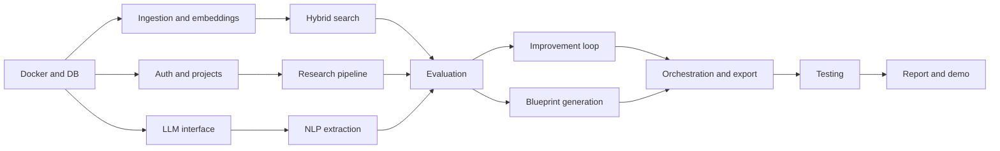

# Ideaform: Implementation Plan

| Field | Value |
| --- | --- |
| Document | implementation_plan.md |
| Version | 1.0 (blueprint freeze) |
| Duration | 12 weeks (adjust to your lab schedule) |
| Related docs | SRS.md, architecture.md, database_design.md, AI_DESIGN.md |

---

## 1. Strategy

1. **Build vertically first.** Get one sample idea working end-to-end (even crudely) by the end of Phase 2, then deepen each stage.
2. **Freeze the blueprint.** Architecture changes after Week 1 require team agreement and a note in this file.
3. **Phase gates.** A phase is complete only when its "Done when" criteria pass.
4. **Protect the demo.** Keep pre-generated sample projects and a recorded walkthrough as backup.
5. **Lab core = Phases 1 to 4.** Phase 5 is included if time allows; Phase 6 is future work.

---

## 2. Team Roles (edit for your group)

| Role | Main responsibility | Owner |
| --- | --- | --- |
| Backend and database lead | FastAPI, PostgreSQL, auth, migrations, export | [Name] |
| AI / RAG lead | NLP, embeddings, hybrid search, research pipeline | [Name] |
| Agents and evaluation lead | Prompts, agents, scoring, improvement loop | [Name] |
| Frontend and documentation lead | Next.js UI, diagrams, report, presentation | [Name] |

*For a smaller team, merge roles. Everyone must be able to explain the whole system.*

---

## 3. Repository Structure

```
ideaform/
  docker-compose.yml
  .env.example
  README.md
  docs/
    SRS.md  architecture.md  database_design.md
    implementation_plan.md  AI_DESIGN.md
  backend/   (see architecture.md section 4)
  frontend/
  data/
    knowledge_seed/     # KB-A and KB-B seed URLs, sitemaps, adapters and metadata
    scraped_corpus/     # cached raw pages and extracted text for offline demos
    test_ideas/         # sample ideas and expected outputs
    eval/               # labelled queries and rubrics
  scripts/              # seed, ingest, backup, run_eval
```

Git workflow: `main` (stable) and `dev`; feature branches `feature/<name>`; pull request with one reviewer; commit messages like `feat: add hybrid search`.

---

## 4. Phase Plan

### Week 1: Phase 0, Setup and Blueprint
**Tasks**
- Finalise project name and scope with the instructor; submit the proposal.
- Finalise the five blueprint documents.
- Create the GitHub repo, branches, and folder structure.
- Write `docker-compose.yml` (db with pgvector, redis, api, worker, web) and `.env.example`.
- Benchmark the Groq models (`openai/gpt-oss-20b` and `openai/gpt-oss-120b`): record latency and token cost for one classification, one extraction, and one evaluation.
- Get one `GROQ_API_KEY` for the hosted LLM and one `TAVILY_API_KEY` for live discovery; set spending limits on both and keep both keys in `.env` only.
- Survey scraping targets per category: robots.txt, terms, rate limits, static vs JS-rendered, and which platforms are legally usable.
- Collect 10 sample ideas (3 business, 3 software, 3 technology, 1 vague) for testing.

**Done when:** `docker compose up` starts all services with `GROQ_API_KEY` and `TAVILY_API_KEY` in `.env`, the API health endpoint returns OK, and one Tavily-discovered page round-trips into `research_sources` with licence metadata.

---

### Weeks 2 to 3: Phase 1, Foundation
**Tasks**
| # | Task | Depends on | Owner |
| --- | --- | --- | --- |
| 1.1 | SQLAlchemy models and Alembic migrations for all tables | Phase 0 | Backend |
| 1.2 | Auth: register, login, JWT, ownership checks | 1.1 | Backend |
| 1.3 | Project CRUD and versions endpoints | 1.1, 1.2 | Backend |
| 1.4 | Frontend: login, dashboard, "New Project" guided flow | 1.2 | Frontend |
| 1.5 | Groq LLM client behind an `LLMProvider` interface, with JSON-validated output (Pydantic) and one repair attempt | Phase 0 | AI |
| 1.6 | NLP: category classification and structured idea extraction | 1.5 | AI |
| 1.7 | Requirement extraction and confirmation screen | 1.6, 1.4 | AI + Frontend |
| 1.8 | Background job set-up (Celery) and run status endpoint | 1.1 | Backend |

**Done when:** a user can log in, create a project, and see and edit the extracted structure and requirements.

---

### Weeks 4 to 5: Phase 2, Intelligence
**Tasks**
| # | Task | Depends on | Owner |
| --- | --- | --- | --- |
| 2.1 | Document ingestion: load, clean, chunk, tag metadata | 1.1 | AI |
| 2.2 | Embedding generation and pgvector storage | 2.1 | AI |
| 2.3 | Build the KB-A corpus from the curated source catalogue (EDGAR, GLEIF, World Bank, OECD/Eurostat, Wikipedia/Wikidata, HN, case studies, datasets) with licence + attribution per row | 2.1 | AI |
| 2.3b | Build KB-B (technical) through the same adapter pipeline from docs, MDN, and GitHub READMEs | 2.3 | AI |
| 2.4 | Keyword search (PostgreSQL full-text) | 2.1 | AI |
| 2.5 | Hybrid retrieval with reciprocal rank fusion and metadata filters | 2.2, 2.4 | AI |
| 2.6 | Reranking step | 2.5 | AI |
| 2.7 | Isolation filter tests (user A cannot see user B's KB-C) | 2.5 | Backend |
| 2.8 | Scraper core: httpx fetcher, robots.txt + terms guard, per-domain rate limiter, retries | 1.8 | AI |
| 2.8b | Text extraction (trafilatura/readability), Playwright rendering for JS pages, quality and dedupe filters | 2.8 | AI |
| 2.8c | Tavily discovery client (caching, spend cap, fallback to cached results then seeds) plus query planning from the structured idea | 2.8 | AI |
| 2.8d | Platform adapters (generic, Wikipedia, GitHub, docs sites, public forums/reviews) behind one interface | 2.8b | AI |
| 2.8e | Scrape compliance tests: robots-blocked URLs never fetched; per-domain delay honoured | 2.8 | Backend |
| 2.8f | Credential hygiene: `.env` ship-check ensures the Groq and Tavily keys stay environment-only, with no key in code, images or the browser | 2.8 | Backend |
| 2.9 | Citation model: sources and dates attached to every passage | 2.8 | AI |
| 2.10 | Research tab in UI: sources list with links | 2.9, 1.4 | Frontend |
| 2.11 | Upload private documents into KB-C (optional) | 2.1 | Backend |

**Done when:** for a sample idea, the system retrieves relevant passages with sources, and hybrid search beats vector-only on the labelled query set.

**Milestone M1 (end of Week 5): first end-to-end vertical slice** (idea, extraction, research, retrieval shown in UI).

---

### Weeks 6 to 7: Phase 3, Evaluation
**Tasks**
| # | Task | Depends on | Owner |
| --- | --- | --- | --- |
| 3.1 | Evaluation prompts and schema (six dimensions) | 2.5 | Agents |
| 3.2 | Score, explanation, citations, assumptions, confidence, recommendations | 3.1 | Agents |
| 3.3 | Claim labelling (`verified_fact`, `assumption`, `ai_suggestion`) | 3.2 | Agents |
| 3.4 | Competitor analysis (extraction and table) | 2.8 | Agents |
| 3.5 | Business model analysis | 3.2 | Agents |
| 3.6 | Risk identification and Devil's Advocate | 3.2 | Agents |
| 3.7 | Improvement suggestions and alternatives | 3.6 | Agents |
| 3.8 | Improvement loop: accept/reject/edit, new version, re-evaluate | 3.7, 1.3 | Backend + Agents |
| 3.9 | Version comparison endpoint and UI | 3.8 | Frontend |
| 3.10 | Evaluation tab: score cards with expandable sources and disclaimer | 3.2 | Frontend |

**Done when:** a full evidence-based evaluation is generated, and after editing the idea the user sees a before/after comparison.

**Milestone M2 (end of Week 7): evaluation and improvement loop demo-ready.**

---

### Week 8: Phase 4, Blueprint Generation
**Tasks**
| # | Task | Depends on | Owner |
| --- | --- | --- | --- |
| 4.1 | PRD generator | 3.x | Agents |
| 4.2 | Architecture description and Mermaid diagrams | 4.1 | Agents |
| 4.3 | Database schema generation | 4.2 | Agents |
| 4.4 | API specification generation | 4.2 | Agents |
| 4.5 | UI/UX concepts (user flows, screens, wireframe descriptions) | 4.1 | Agents |
| 4.6 | Development roadmap generator | 4.2 to 4.5 | Agents |
| 4.7 | Artifacts storage, versions, editing | 1.1 | Backend |
| 4.8 | Regenerate a single section | 4.7 | Backend + Agents |
| 4.9 | Blueprint tab with Mermaid viewer | 4.7 | Frontend |

**Done when:** one idea produces a complete blueprint and any section can be regenerated alone.

**Milestone M3 (end of Week 8): complete idea-to-blueprint flow.**

---

### Week 9: Phase 5, Orchestration and Export (if time allows)
**Tasks**
- Wrap the logic in the six agents with the LangGraph orchestrator and shared state.
- Add evidence validation node and retry or "low confidence" handling.
- Record `agent_runs` with timings and token usage; show progress in UI.
- Export: Markdown, PDF (ReportLab), ZIP of all artifacts.
- Artifact version history screen.

**Done when:** one submission runs the whole pipeline automatically and exports a PDF and ZIP.

*If time is short:* keep a simple sequential pipeline instead of LangGraph branching, and implement Markdown and PDF export only.

---

### Week 10: Testing and Polish
**Tasks**
- Run all 10 sample ideas; record results (see `AI_DESIGN.md` section 10).
- Measure NLP accuracy, retrieval quality (hybrid vs vector-only vs keyword-only), citation validity, score stability.
- Unit and integration tests (pytest): auth, isolation, retrieval, schema validation, export.
- Handle errors: blocked pages, timeouts, empty crawl results, malformed model JSON, vague ideas, very long inputs.
- Prompt improvements based on failures.
- UI polish and loading/progress states.

**Done when:** the test report is complete, with no known blocking bugs.

---

### Weeks 11 to 12: Documentation, Demo, Submission
**Tasks**
- README with setup, `.env` guide, run instructions, and sample data.
- Final report: introduction, problem, methodology, implementation, results, limitations, conclusion, acknowledgements.
- Presentation slides and demo script (see section 8).
- Record the demo walkthrough as backup.
- Dry run with a team member acting as evaluator; prepare answers for likely questions.
- Final submission and live demonstration.

---

## 5. Timeline Summary

| Week | Focus | Milestone |
| --- | --- | --- |
| 1 | Setup, blueprint freeze | Services run in Docker |
| 2 to 3 | Phase 1: Foundation | Create projects, see extracted requirements |
| 4 to 5 | Phase 2: Intelligence | **M1:** research and retrieval slice |
| 6 to 7 | Phase 3: Evaluation | **M2:** evaluation and improvement loop |
| 8 | Phase 4: Blueprint | **M3:** full blueprint |
| 9 | Phase 5: Orchestration and export | Automated run and export |
| 10 | Testing and polish | Test report |
| 11 to 12 | Report, demo, submission | Final delivery |

---

## 6. Dependencies (critical path)



The **critical path** is: Docker and DB, ingestion and embeddings, hybrid search, evaluation, blueprint generation, testing, demo.

---

## 7. Risk Register

| Risk | Likelihood | Impact | Mitigation |
| --- | --- | --- | --- |
| Tavily quota exhausted or API down | Medium | Medium | 7-day result cache; fall back to curated seeds and cached corpora; pre-scraped demo data |
| Local model too slow or too weak for the demo hardware | Medium | High | Quantised models; fast/strong split; cached runs; extractive fallback mode; pre-generated sample projects |
| Target sites block scraping or change markup | High | Medium | robots/terms guard; per-platform adapters; cached corpora; pre-scraped demo data; user-supplied seed URLs |
| Scope creep | High | High | Frozen blueprint; "do not build initially" list; phase gates |
| Poor retrieval quality | Medium | Medium | Hybrid search, reranking, labelled query set, tuning chunk size |
| LLM output not valid JSON | Medium | Medium | Pydantic validation, one repair retry, simpler schemas |
| Team member unavailable | Medium | Medium | Shared code ownership, pull-request reviews, documented setup |
| Slow generation in demo | Medium | Medium | Background jobs with progress, cached results, recorded demo |
| Hallucinated facts | High | High | Citations, claim labels, evidence validation step |
| Docker or environment problems | Medium | Medium | Test on every machine in Week 1; README troubleshooting |
| Not enough time for orchestration | Medium | Low | Sequential pipeline fallback |

---

## 8. Demo Plan

**Duration:** about 8 to 10 minutes.

1. **Problem (1 min):** one unexplained AI score vs evidence-based analysis.
2. **Create project (1 min):** "AI platform helping university students find affordable tutors"; show extracted requirements.
3. **Research (2 min):** sources with links; show hybrid search benefit.
4. **Evaluation (2 min):** six score cards; open one to show explanation, citations, assumptions, confidence.
5. **Improvement loop (2 min):** accept a suggestion, re-evaluate, show comparison.
6. **Blueprint (1 min):** PRD, architecture diagram, schema; regenerate one section.
7. **Export (30 s):** PDF and ZIP.
8. **Limitations and future work (30 s).**

**Backup plan:** pre-generated project, recorded video, screenshots in the slides.

---

## 9. Definition of Done

A task is done when:
- code is committed, reviewed, and merged to `dev`;
- it follows the SRS requirement it implements;
- it has at least basic tests;
- it handles errors without crashing;
- it is described in the README or docs where needed;
- the author can explain it.

---

## 10. Final Deliverables Checklist

| Deliverable | Status | Owner |
| --- | --- | --- |
| Project proposal | | |
| Source code with README and run instructions | | |
| Dataset and resources list (links, descriptions) | | |
| Test ideas and results | | |
| Final report | | |
| Presentation | | |
| Demo (live and recorded backup) | | |
| Acknowledgement of external code, APIs, models, datasets | | |

---

## 11. Do Not Build Initially (reminder)

- Autonomous coding and deployment
- Any second AI provider integration (one provider interface, Groq) or third-party scraping API (our own scraper only)
- Training your own LLM or separate models per agent
- Crawling the entire internet
- Promising accurate startup success predictions
- Figma-quality editable designs
- Complex financial simulations before basic evaluation works
